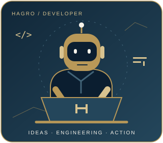

  

<a href="assets/wave-banner-reference-static.svg">배너 정적 보기</a>

<!-- 저장소의 실제 소개·기술·브랜드 문구를 유지한 HAGRO 프로필. -->
<picture>
  <source media="(prefers-reduced-motion: reduce)" srcset="assets/developer-static.svg" />
  
</picture>

## 👋 Hello, I'm HUGO JANG

**Building software, systems, and AI orchestration.**

I'm a software developer specializing in web, mobile, and Windows desktop applications.

My work spans frontend and backend development, software architecture, and system integration.

**Full-Stack Development · Systems Engineering · AI Orchestration**

 

---

## 👤 About Me

- Building practical, reliable, and maintainable software
- Working across frontend, backend, and system integration
- Developing web, mobile, and Windows desktop applications
- Exploring AI orchestration and engineering automation

 

## 🧩 Tech Stack

| Area | Technologies |
| :--- | :--- |
| Languages | Java · JavaScript · TypeScript · VB.NET |
| Frontend & Mobile | React · Flutter · HTML · CSS |
| Backend & Database | Node.js · PostgreSQL |
| Tools | Git · GitHub |

  

**Also working with:** VB.NET and Windows desktop application development.

---

<table>
  <tr>
    <td valign="top" width="50%">
      <h2>🎯 Technical Interests</h2>
      <ul>
        <li>AI orchestration systems</li>
        <li>Multi-agent architecture and coordination</li>
        <li>Agent communication and workflow management</li>
        <li>Developer tools and engineering automation</li>
      </ul>
    </td>
    <td valign="top" width="50%">
      <h2>HAGRO</h2>
      
      
<strong>Personal Brand · Engineering Philosophy</strong>

      
<em>Aim Higher. Build Better.</em>

      
HAGRO is my personal brand, representing my pursuit of higher ground through ideas, engineering, and action.

    </td>
  </tr>
</table>

## 🐍 GitHub Snake

<picture>
  <source media="(prefers-color-scheme: dark)" srcset="assets/snake-dark.svg" />
  
</picture>

[Contribution profile](https://github.com/Hugo-Jang?tab=overview) · [Static view](assets/snake-light-static.svg)

Principles

**Well done is better than well said.**

— Benjamin Franklin

*Knowing is not enough; we must apply. Willing is not enough; we must do.*

— Bruce Lee

<!-- 디자인 출처·접근성·에셋 유지보수: assets/README.md -->
