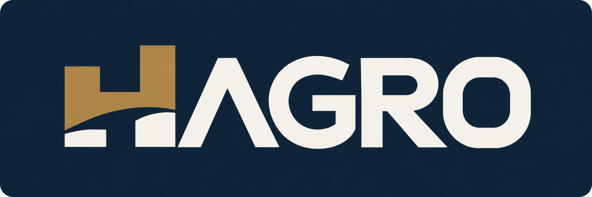
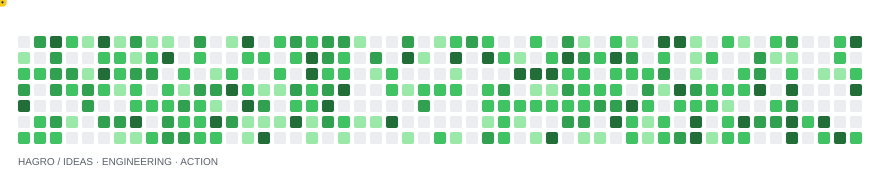

  

<!-- 저장소의 실제 소개·기술·브랜드 문구를 유지한 HAGRO 프로필. -->
## 👋 Hello, I'm HUGO JANG

<picture>
  <source media="(prefers-reduced-motion: reduce)" srcset="assets/hagro-character-logo-cleaned-2x-static.png" />
  
</picture>

**Web · Mobile · Windows Desktop**

I develop applications across frontend and backend, and integrate them with databases and existing systems.

 

---

## 👤 About Me

- Practical solutions with reliability and maintainability in mind
- Continuous improvement through hands-on development
- Exploring AI orchestration and workflow automation

 

## 🧩 Tech Stack

| Area | Technologies |
| :--- | :--- |
| Languages | Java · JavaScript · TypeScript · VB.NET |
| Frontend & Mobile | React · Flutter · HTML · CSS |
| Backend & Database | Node.js · MySQL · PostgreSQL |
| Tools | Git · GitHub |

  

---

## HAGRO

**Personal Brand · Engineering Philosophy**

*Aim Higher. Build Better.*

HAGRO is my personal brand, representing my pursuit of higher ground through ideas, engineering, and action.

 

## 🐍 GitHub Snake

<picture>
  <source media="(prefers-color-scheme: dark)" srcset="assets/snake-dark.svg" />
  
</picture>

---

### Principles

> **Well done is better than well said.**
>
> — Benjamin Franklin

> *Knowing is not enough; we must apply. Willing is not enough; we must do.*
>
> — Bruce Lee

<!-- 디자인 출처·접근성·에셋 유지보수: assets/README.md -->
